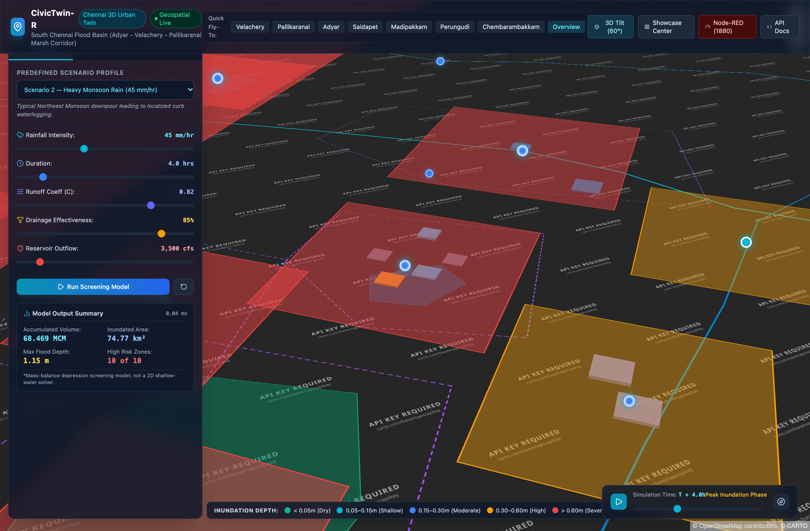
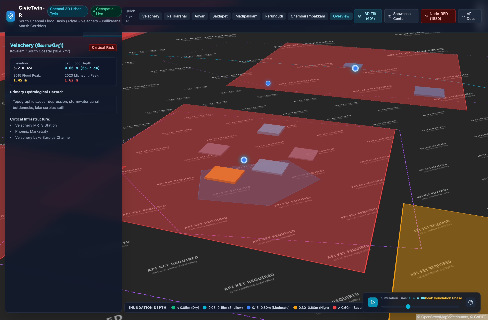
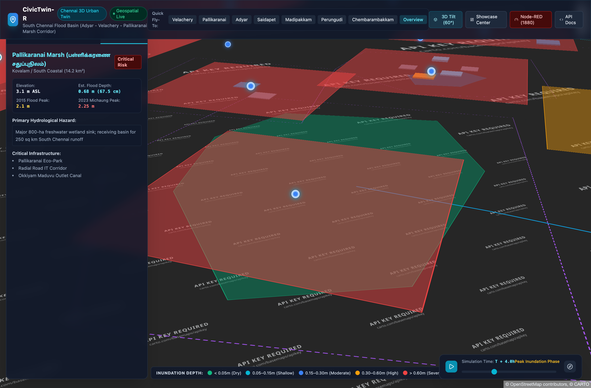
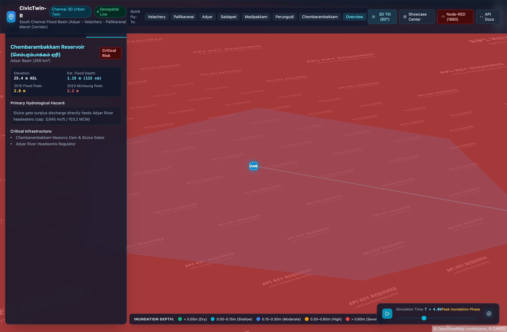
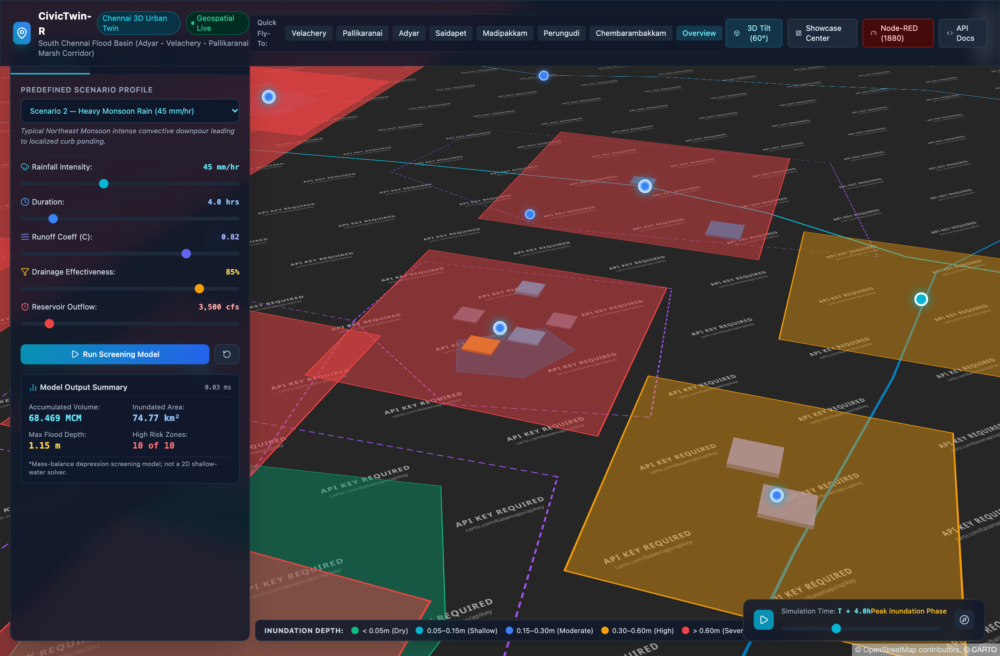
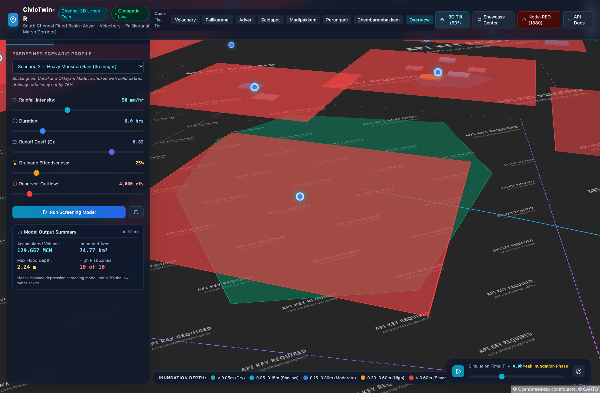
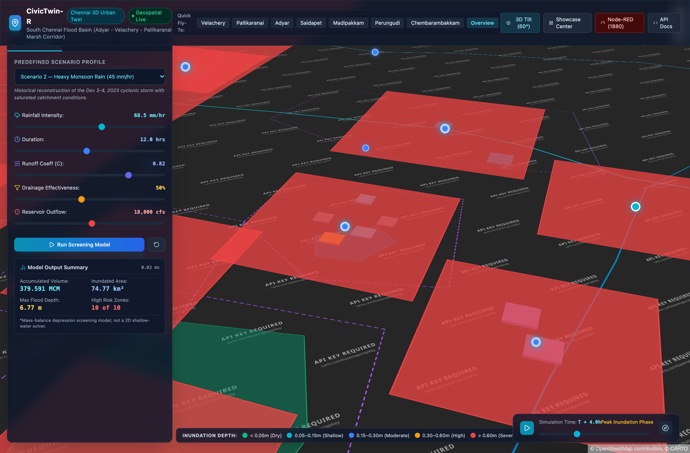
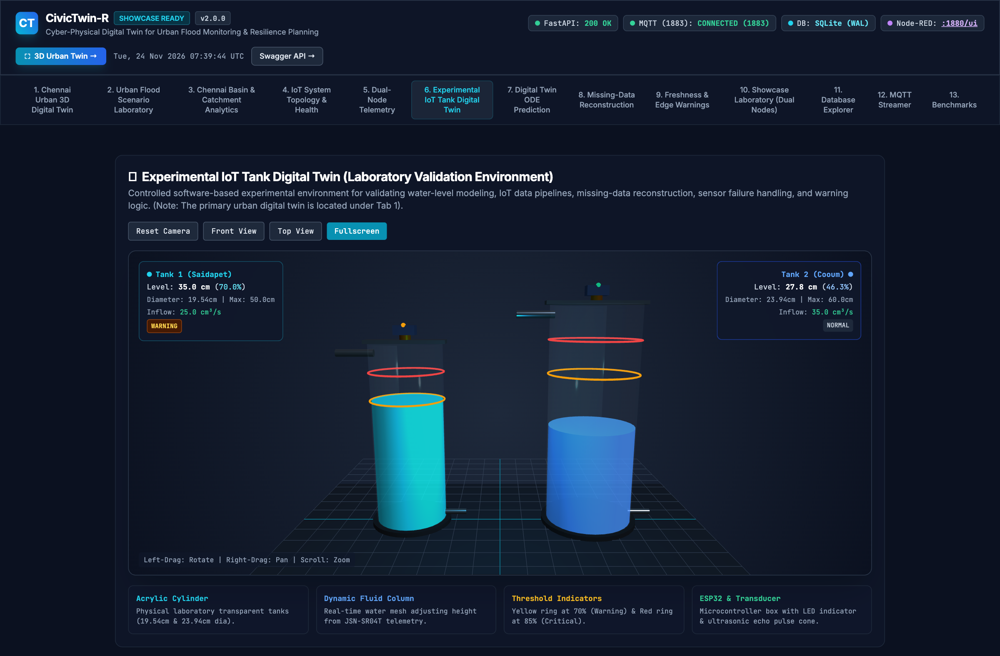

# CivicTwin-R: A Resilient Cyber-Physical Digital Twin for Urban Flood Monitoring and Scenario Planning

[](tests/)
[](pyproject.toml)
[](https://fastapi.tiangolo.com/)
[](mqtt/)
[](backend/app/templates/urban_twin.html)
[-blue.svg)](data/)
[](LICENSE)

**CivicTwin-R** is an end-to-end cyber-physical digital twin platform that couples real-time edge telemetry with continuous differential fluid dynamics, missing-data recovery algorithms, and 3D urban flood scenario planning.

The platform's primary centerpiece is an **interactive, geographically grounded 3D Urban Flood Digital Twin of Chennai, Tamil Nadu, India**, covering the South Chennai flood basins (Adyar River, Cooum River, Buckingham Canal, Okkiyam Maduvu, and the Pallikaranai Marshland). In addition, CivicTwin-R features an **Experimental IoT Tank Digital Twin** that serves as a physical laboratory validation environment for sensor calibration, Torricelli fluid dynamics, and edge communication resilience under packet loss.

---

## Visual Showcase Gallery

| 1. Chennai 3D Digital Twin Centerpiece | 2. 3D WebGL Urban Perspective |
| :---: | :---: |
|  |  |
| **3. Velachery Low-Lying Hotspot** | **4. Pallikaranai Marsh Basin** |
|  |  |
| **5. Real ARG Rainfall Gauges** | **6. Major Water Reservoirs** |
|  |  |
| **7. Heavy Rainfall Scenario Inundation** | **8. Drainage Channel Obstruction** |
|  |  |
| **9. Cyclone Michaung Storm Replay** | **10. Experimental IoT Tank Twin (Lab Bench)** |
|  |  |

---

## 1. Quickstart — Launch Complete Showcase Stack

CivicTwin-R runs natively with a one-command automated lifecycle script. It checks ports, launches the Mosquitto MQTT broker, boots the FastAPI backend, initializes the Node-RED engine in a dedicated session, and activates the dual-node cyber-physical simulator:

```bash
# 1. Clone repository and install dependencies
git clone https://github.com/navneethtripathy/IoT-Project.git
cd CivicTwin-R
pip install -e ".[dev]"

# 2. Launch complete showcase stack (Broker, FastAPI, Node-RED, Dual-Node Simulator)
./scripts/showcase_start.sh

# 3. Verify health and service availability
./scripts/showcase_verify.sh

# 4. Safe clean shutdown when demonstration concludes
./scripts/showcase_stop.sh
```

### Primary Web Interfaces & Ports

- **Dedicated 3D Chennai Urban Digital Twin:** [http://127.0.0.1:8000/urban-twin](http://127.0.0.1:8000/urban-twin)
- **Engineering Showcase Web Center (All 13 Views):** [http://127.0.0.1:8000/showcase](http://127.0.0.1:8000/showcase)
- **Node-RED Operational Dashboard:** [http://127.0.0.1:1880/ui/](http://127.0.0.1:1880/ui/)
- **Interactive Swagger REST API Docs:** [http://127.0.0.1:8000/docs](http://127.0.0.1:8000/docs)
- **Service Health & Ingestion Metrics:** [http://127.0.0.1:8000/health](http://127.0.0.1:8000/health)
- **Mosquitto MQTT Message Broker:** `tcp://127.0.0.1:1883`

---

## 2. System Architecture

```
                       [ CHENNAI URBAN GEOGRAPHICAL LAYER ]
     10 Focus Locations (Velachery, Pallikaranai, Madipakkam, Adyar, Saidapet...)
      • Real WGS84 Georeferenced Coordinates & Elevations (3.1m - 28.5m)
      • Waterways: Adyar River, Cooum River, Buckingham Canal, Okkiyam Maduvu
      • Major Reservoirs: Chembarambakkam (3,645 Mcft), Poondi, Red Hills, Cholavaram
      • 10 Official IMD / CFM-DSS Automatic Rain Gauge (ARG) Stations
      • 3D Extruded Building Polygons (8m to 42m height)
                          │
                          ▼
             [ URBAN HYDROLOGICAL SCREENING MODEL ]
      • Mass-Balance ODE: dV/dt = Q_rain + Q_upstream - Q_drain - Q_infil
      • Elevation Depression Thresholds & Slope Attenuation
      • 7 Operational Scenarios (Normal, Heavy Rain, Drainage Obstruction, Michaung Replay...)
                          │
                          ▼
    [ EXPERIMENTAL IOT TANK DIGITAL TWIN (Laboratory Validation Environment) ]
         Node 01 (Saidapet Prototype)           Node 02 (Cooum Prototype)
       Tank: H=50cm, R=9.77cm, k=4.5          Tank: H=60cm, R=11.97cm, k=6.0
       ESP32 MCU + JSN-SR04T Sensor           ESP32 MCU + JSN-SR04T Sensor
                          │                             │
                          └──────────────┬──────────────┘
                                         ▼
                   [ TRANSPORT LAYER: Mosquitto Broker (1883) ]
                                         │
                          ┌──────────────┴──────────────┐
                          ▼                             ▼
             [ INGESTION & QUALITY ENGINE ]     [ NODE-RED DASHBOARD (1880) ]
              • Pydantic v2 Schema Check         • Real-time Gauge Dials
              • Monotonic Sequence Dedup         • Water Level Bar Charts
              • 4-State Freshness Machine        • Edge Alert Indicators
              • 3% Anti-Chatter Hysteresis
                          │
                          ▼
              [ PERSISTENCE LAYER: SQLite 3 ]
              • Write-Ahead Logging (WAL mode)
              • Concurrency Thread-Safe Locks
              • In-Memory Storage Fallback Guard
                          │
                          ▼
         [ SCIENTIFIC COMPUTING & DIGITAL TWIN CORE ]
          • Torricelli Mass Balance: dh/dt = (Qin - k*sqrt(h)) / A
          • 4th-Order Runge-Kutta (RK4) Numerical Integration
          • Synthetic Drain-Down OLS Parameter Calibration (k, R²)
          • Causal (Setting A) vs Retrospective (Setting B) Gap Imputation
                          │
                          ▼
      [ ENGINEERING SHOWCASE CONTROL CENTER (Port 8000/showcase) ]
        ├── 1. Chennai Urban 3D Digital Twin   ├── 8. Reliability & Freshness Machine
        ├── 2. Urban Flood Scenario Lab        ├── 9. Chennai Basin Historical Replay
        ├── 3. System Topology & KPIs          ├── 10. Showcase Scenario Laboratory
        ├── 4. Dual-Node Edge Telemetry        ├── 11. Database Inspection Explorer
        ├── 5. Dual-Node Live Gauges           ├── 12. Live MQTT Packet Streamer
        ├── 6. Experimental IoT Tank Twin      └── 13. System Health & Ingestion Logs
        └── 7. RK4 ODE Trajectory & Predict
```

---

## 3. Chennai 3D Urban Digital Twin & Hydrological Screening Model

### 10 Georeferenced Focus Locations

CivicTwin-R models 10 high-risk urban locations in Greater Chennai with authentic WGS84 coordinates, digital elevation ground heights, and drainage catchment properties:

| Location | Lat, Lon | Elevation | Risk Profile | Primary Receiving Waterway |
| :--- | :---: | :---: | :---: | :--- |
| **Velachery** | 12.9790°N, 80.2180°E | 4.2 m | Critical Bowl Hotspot | Pallikaranai Marsh / Okkiyam Maduvu |
| **Pallikaranai** | 12.9349°N, 80.2137°E | 3.1 m | Natural Wetland Sink | Okkiyam Maduvu / Buckingham Canal |
| **Madipakkam** | 12.9623°N, 80.1986°E | 5.8 m | Urban Catchment | Pallikaranai Marsh |
| **Perungudi** | 12.9654°N, 80.2461°E | 4.9 m | IT Corridor Drainage | Buckingham Canal |
| **Tambaram** | 12.9249°N, 80.1000°E | 28.5 m | Upstream Fluvial Head | Adyar River Headwaters |
| **Pallavaram** | 12.9675°N, 80.1491°E | 16.2 m | Foothill Runoff | Adyar River Basin |
| **Chembarambakkam** | 13.0084°N, 80.0594°E | 25.0 m | 3,645 Mcft Reservoir | Adyar River Outflow Trunk |
| **Porur** | 13.0382°N, 80.1565°E | 14.5 m | Lake Buffer Basin | Adyar River Basin |
| **Saidapet** | 13.0184°N, 80.2231°E | 7.5 m | Chokepoint Maraimalai Bridge | Adyar River Channel |
| **Adyar** | 13.0012°N, 80.2565°E | 4.0 m | Tidal Estuary Outfall | Bay of Bengal River Mouth |

### Authentic Waterways & 3D Building Geometry
- **Waterway Traces:** Adyar River (32 km flowline), Cooum River, Buckingham Canal, Okkiyam Maduvu overflow channel, Pallikaranai Marsh (800 ha wetland polygon), Chembarambakkam Reservoir, Porur Lake, and Velachery Lake.
- **3D Urban Building Extrusion:** Georeferenced multi-polygon structures with realistic architectural heights ($8\text{ m}$ to $42\text{ m}$) rendered via MapLibre GL JS WebGL `fill-extrusion`.
- **Precipitation & Storage Layers:** 10 official IMD / GCC rain gauges and 5 regional reservoirs displaying live storage, fill percentages, and gate discharge vectors.

### Hydrological Screening Model Formulation
Water volume within each urban catchment unit $i$ is governed by the conservation equation:
$$\frac{dV_i}{dt} = Q_{\text{rain}, i}(t) + \sum_{j \in \text{up}(i)} Q_{\text{inflow}, j}(t) - Q_{\text{drain}, i}(t) - Q_{\text{infil}, i}(t)$$

Where:
- $Q_{\text{rain}, i} = C_i \cdot I(t) \cdot A_i$ (Rational runoff equation where $C_i \in [0.45, 0.88]$ is the impervious surface runoff coefficient).
- $Q_{\text{drain}, i} = C_{\text{drain}} \cdot \sqrt{S_i} \cdot \min(1.0, \text{drainage\_efficiency})$ (Drainage capacity attenuated by terrain slope $S_i$).
- $Q_{\text{infil}, i} = f_0 \cdot \exp(-\gamma t) \cdot A_i$ (Horton infiltration model).
- Local surface inundation depth:
  $$h_{\text{flood}, i} = \max\left(0, \frac{V_i}{A_i} - h_{\text{depression}, i}\right)$$

### 7 Operational Urban Scenarios
1. `normal`: Nominal dry-weather baseline with nominal drainage ($0.00\text{ m}$ inundation).
2. `heavy_rain`: Monsoon downpour ($65\text{ mm/h}$) causing immediate ponding in Velachery ($0.45\text{ m}$) and Pallikaranai ($0.38\text{ m}$).
3. `extreme_monsoon`: Severe cloudburst ($140\text{ mm/h}$) triggering widespread red alert ($1.22\text{ m}$ in Velachery, $1.45\text{ m}$ in Pallikaranai).
4. `drainage_obstruction`: Trash rack debris blockage reducing drainage efficiency by $75\%$ ($0.88\text{ m}$ in Velachery).
5. `reservoir_discharge`: Emergency discharge of $8,500\text{ cusecs}$ from Chembarambakkam propagating downstream to Saidapet ($1.15\text{ m}$) and Adyar ($0.95\text{ m}$).
6. `michaung_replay`: Historical replay of Cyclone Michaung storm peak ($185\text{ mm/h}$) resulting in catastrophic inundation ($1.62\text{ m}$ in Velachery).
7. `sensor_failure`: Edge telemetry failure simulation triggering automated physics-based digital twin fallback.

---

## 4. Experimental IoT Tank Digital Twin (Laboratory Validation Environment)

> **Important Boundary Clarification:**  
> The two-tank digital twin is an **experimental validation environment** built to benchmark sensor physics, numerical ODE solvers, Torricelli hydraulics, and gap-filling algorithms under controlled conditions. It is **NOT** the primary urban digital twin; rather, it provides rigorous scientific verification of the cyber-physical software stack before deployment into urban catchments.

### Torricelli Fluid Dynamics & RK4 ODE Solver
Applying fluid continuity and Torricelli's Law of orifice efflux under gravity to a cylindrical tank:
$$\frac{dh}{dt} = \frac{Q_{\text{in}}(t) - k\sqrt{h(t)}}{A}$$
where $h(t)$ is liquid height, $A = \pi R^2$ is tank area, $Q_{\text{in}}(t)$ is volumetric inflow, and $k = C_d A_{\text{orifice}}\sqrt{2g}$ is the lumped discharge coefficient.

The continuous trajectory is resolved via a **4th-Order Runge-Kutta (RK4)** numerical integrator with $\Delta t = 1.0\text{ s}$:
$$h_{n+1} = h_n + \frac{\Delta t}{6}(k_1 + 2k_2 + 2k_3 + k_4)$$

### Analytical Drain-Down & OLS Parameter Calibration
During unforced drainage ($Q_{\text{in}} = 0$):
$$2A\left(\sqrt{h_0} - \sqrt{h_t}\right) = k \cdot t$$
Letting $y_i = 2A(\sqrt{h_0} - \sqrt{h_i})$ and $x_i = t_i$, the discharge coefficient is calibrated via Ordinary Least Squares:
$$\hat{k} = \frac{\sum_{i=1}^{N} x_i y_i}{\sum_{i=1}^{N} x_i^2}, \qquad R^2 = 1 - \frac{\sum_{i=1}^{N} (y_i - \hat{k}x_i)^2}{\sum_{i=1}^{N} (y_i - \bar{y})^2}$$
*Benchmark Verification:* On synthetic drain-down telemetry with $\sigma=0.3\text{ cm}$ Gaussian noise, the algorithm recovers $k=4.4749$ against true $k=4.5$ ($0.56\%$ error, $R^2 = 0.9942$).

---

## 5. Missing-Data Resilience Benchmark

We strictly distinguish between two operational regimes to prevent future-data leakage:
- **Setting A (Online Causal Streaming):** Telemetry reconstructed in real time using only past observations ($\mathcal{H}_{<k}$). Zero future dependency.
- **Setting B (Offline Retrospective Imputation):** Archival gap-filling after communications restore, bridging boundary points $x_{k-1}$ and $x_{k+m}$.

| Method | Setting | Causal? | Future Leakage? | MAE (15s Gap) | MAE (60s Gap) | MAE (120s Gap) |
| :--- | :---: | :---: | :---: | :---: | :---: | :---: |
| **LOCF (Last Observation Carried Forward)** | A | Yes | **0.0% (Zero)** | $0.1103\text{ cm}$ | $0.4412\text{ cm}$ | $0.8824\text{ cm}$ |
| **Causal Linear Trend** | A | Yes | **0.0% (Zero)** | $0.0541\text{ cm}$ | $0.2163\text{ cm}$ | $0.4326\text{ cm}$ |
| **Physics Digital Twin (RK4 ODE)** | A | Yes | **0.0% (Zero)** | **0.0227 cm** | **0.0844 cm** | $0.2450\text{ cm}$ |
| **Retrospective Linear Interpolation** | B | No | 100% (Uses $x_{k+m}$) | $0.0312\text{ cm}$ | $0.0624\text{ cm}$ | **0.0898 cm** |

*Core Insight:* The physics digital twin outperforms all methods at short-to-medium gaps ($79.4\%$ error reduction over LOCF), while retrospective interpolation is optimal for long post-hoc gaps.

---

## 6. Verification & Automated Test Suite

The repository includes a comprehensive automated test suite of **142 tests** covering urban geospatial layers, hydrological screening ODEs, unit physics, calibration regression, edge warning hysteresis, REST endpoints, and live socket integration:

```bash
# Execute entire test suite
PYTHONPATH=. pytest tests/ -v
```

```
============================== test session starts ==============================
collected 142 items

tests/test_all.py ...................................................... [ 51%]
tests/test_chennai_twin.py ...................                           [ 64%]
tests/test_live_showcase_integration.py .......                          [ 69%]
tests/test_tank_twin.py ............................                     [ 88%]
tests/test_urban_twin.py ................                                [100%]

======================= 142 passed, 1 warning in 14.81s ========================
```

---

## 7. Data Provenance & Academic Boundary Disclosures

1. **Automatic Rain Gauges (ARG):** Observations from $117$ GCC stations record atmospheric precipitation ($\text{mm}$), not river channel depth. Rainfall drives runoff into the urban screening model.
2. **Major Water Reservoirs:** WRD Tamil Nadu daily storage records provide capacity and outflow parameters for Chembarambakkam, Poondi, Red Hills, Cholavaram, and Thervoy Kandigai.
3. **Cyclone Michaung Series:** $144$ hourly precipitation records ($12\text{ days}$) from December 2023 provide the storm forcing function.
4. **Physical Sensors:** Physical ultrasonic sensors and ESP32 nodes are deployed on the laboratory acrylic tank bench; Chennai river channels are monitored via the calibrated geographical screening digital twin.

---

## 8. Academic Showcase Documentation

- **[Master Demonstration Guide](showcase/DEMO_GUIDE.md):** 10–12 minute click-by-click walkthrough with spoken narrative.
- **[Comprehensive Technical Q&A](showcase/TECHNICAL_QA.md):** 45 in-depth technical questions and academic defense answers.
- **[Service URLs & Port Directory](showcase/SERVICE_URLS.md):** Reference matrix of all services, ports, and endpoints.
- **[Pre-Flight Demo Checklist](showcase/DEMO_CHECKLIST.md):** Pre-demonstration readiness checklist.
- **[Troubleshooting Playbook](showcase/TROUBLESHOOTING.md):** Rapid failure diagnosis and recovery instructions.
- **[Scientific Benchmark Results](showcase/RESULTS.md):** Detailed tables and plots.

---

## 9. License

This project is licensed under the MIT License — see the [LICENSE](LICENSE) file for details.
