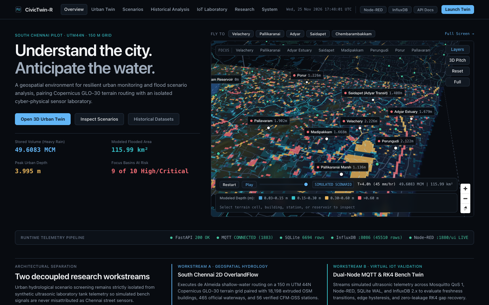
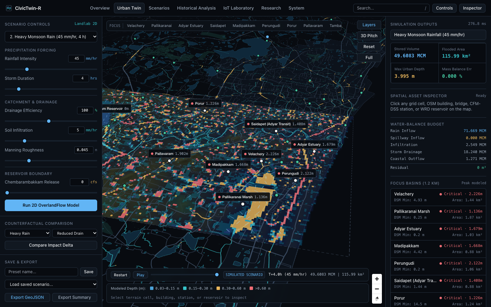
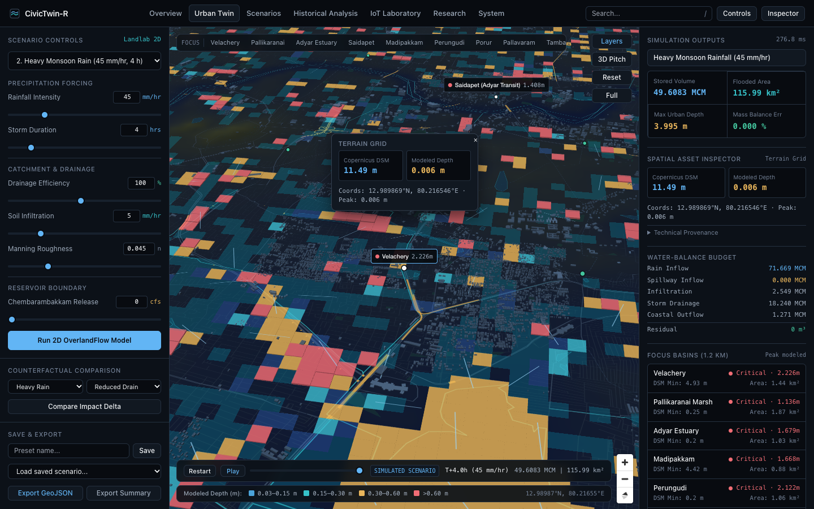
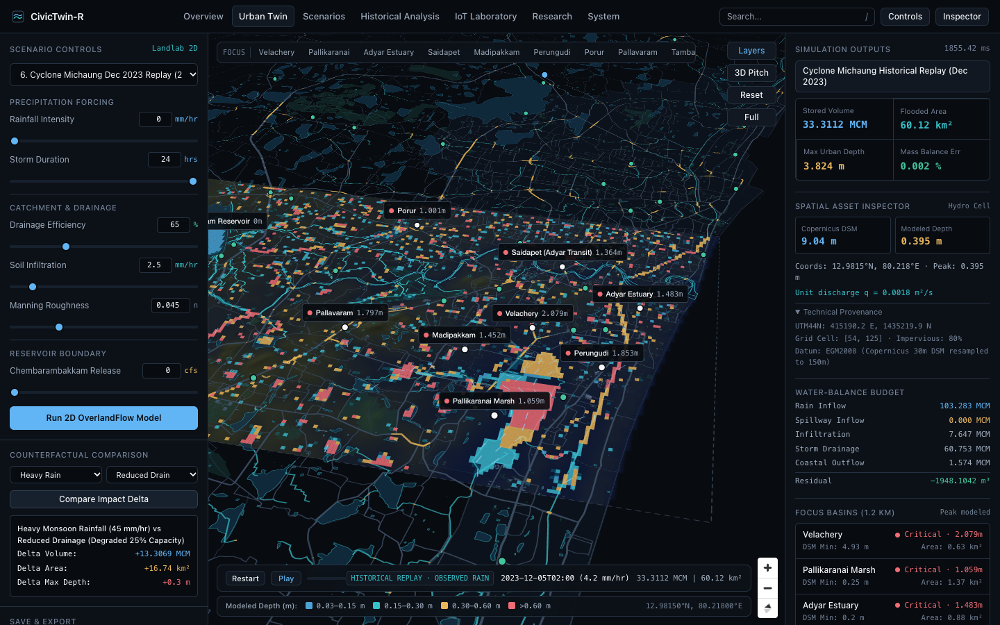
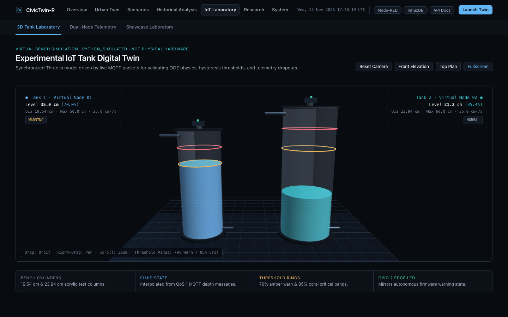
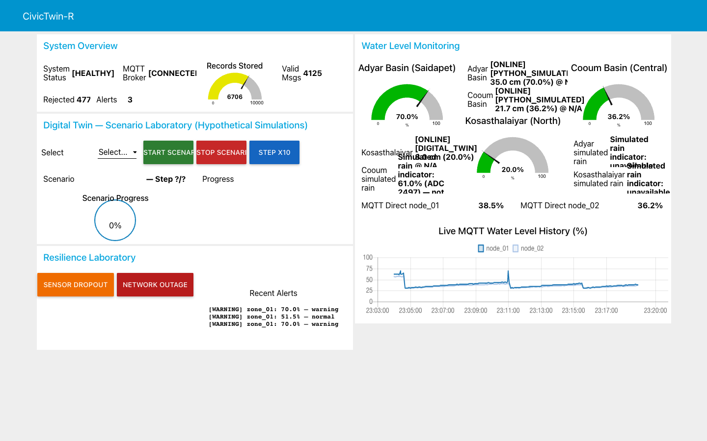
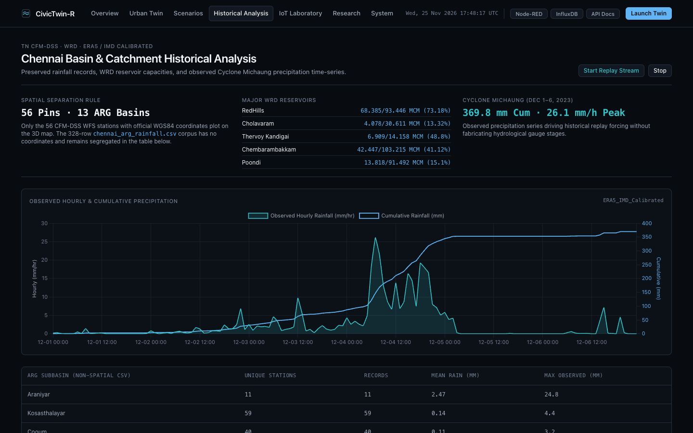

# CivicTwin-R: A Resilient Cyber-Physical Digital Twin for Urban Flood Monitoring and Scenario Planning

[](https://github.com/navneethtripathy/IoT-Project/actions/workflows/ci.yml)
[](LICENSE)

CivicTwin-R is an academic cyber-physical and geospatial digital twin platform combining a 3D terrain-routed urban flood modeling environment for South Chennai (`Landlab 2D OverlandFlow` over `Copernicus GLO-30`, official `TN CFM-DSS WFS`, and `OpenStreetMap` data) with an isolated dual-node IoT telemetry, numerical ODE modeling, and missing-data reconstruction validation pipeline.

---

## 1. Research Problem & Objectives

Urban flash flooding requires integrating sparse environmental monitoring, noisy cyber-physical sensor links, and terrain-governed overland runoff into an interpretable decision-support platform. CivicTwin-R addresses four concrete engineering challenges:

1. **Geospatial Grounding:** Replace synthetic flood boxes with hydro-conditioned 2D shallow-water routing on `EPSG:32644` (`UTM Zone 44N`, `150 m` grid) paired with `18,198` extruded OpenStreetMap buildings, `9,942` major roads, `38,827` pilot streets, `1,229` bridges, and TN CFM-DSS hydrography.
2. **Offline-First 3D Urban Visualization:** Render WebGL terrain relief, waterways, wetlands, and scenario inundation rasters purely from locally served vendor libraries and processed GeoJSON assets (`0` external requests required at runtime).
3. **Dual-Persistence Edge Telemetry:** Sustain resilient telemetry ingestion (`Pydantic v2` schema checks, sequence deduplication, `FRESH`/`STALE`/`OFFLINE` tracking, and `3%` anti-chatter hysteresis) across Mosquitto MQTT (`1883`), SQLite WAL, InfluxDB 2.x (`8086`), and Node-RED (`1880/ui/`).
4. **Zero-Leakage Missing-Data Resilience:** Benchmark causal online streaming recovery (**Setting A**) against retrospective gap interpolation (**Setting B**) using a calibrated 4th-order Runge-Kutta (`RK4`) Torricelli bench twin.

---

## 2. Visual Overview (Actual Application Screenshots)

| Obsidian Ocean Overview Hub (`/showcase`) | Chennai 3D Urban Flood Digital Twin (`/urban-twin`) |
| :---: | :---: |
|  |  |
| **Velachery 3D Buildings & Point Inspector** | **Cyclone Michaung Replay & Impact Delta** |
|  |  |
| **Experimental IoT Tank Twin (`/showcase` IoT Lab)** | **Node-RED Operational Dashboard (`:1880/ui/`)** |
|  |  |
| **InfluxDB 2.x Data Explorer (`:8086`)** | **Historical Basin Analytics (`/showcase`)** |
|  |  |

---

## 3. System Architecture & Core Capabilities

CivicTwin-R enforces strict separation between city-scale hydrological modeling (**Workstream A**) and laboratory bench sensor validation (**Workstream B**):

```text
Workstream A (Urban Twin)                Workstream B (Experimental IoT Tank Twin)
────────────────────────                 ──────────────────────────────────────
Copernicus GLO-30 + WFS + OSM            Node 01 (50 cm) & Node 02 (60 cm)
        │                                        │
        ▼  150m UTM 44N Grid                     ▼  MQTT QoS 1 (127.0.0.1:1883)
Landlab 2D OverlandFlow                  Mosquitto Broker ──► Node-RED (:1880/ui/)
        │                                        │
        ▼                                        ▼
/api/urban/* (FastAPI)                   IngestionService ─► SQLite (WAL) + InfluxDB (:8086)
        │                                        │
        ▼                                        ▼
Offline MapLibre 3D UI (/urban-twin)     RK4 Torricelli Solver & Three.js Twin (/showcase)
```

- **Urban Twin (`/urban-twin`):** Interactive 2D/3D MapLibre GL JS viewer featuring 8 predefined flood scenarios (normal, heavy/extreme rainfall, reduced/improved drainage counterfactuals, Cyclone Michaung 24h replay, monitoring dropout, Chembarambakkam `25,000 cusecs` 12h spillway release), real-time parameter sliders, storm progression playback, side-by-side impact delta comparison, DEM/building click inspection, and GeoJSON/JSON export.
- **Showcase Control Center (`/showcase`):** Unified multi-tab interface embedding the Chennai 3D Twin alongside real-time service status probes (`/api/services/status`), Three.js tank physics, RK4 trajectory comparisons, reconstruction benchmarks, database record explorer, and live MQTT stream inspector.

---

## 4. Urban Modeling & Missing-Data Methodology

- **2D Overland Routing (`digital_twin/terrain_hydrology.py`):** Solves shallow-water continuity (`dh/dt + div(q) = rain + spillway - infiltration - drainage`) via `Landlab OverlandFlow` over hydro-conditioned channels (Adyar, Chembarambakkam surplus, Buckingham Canal, Cooum, Pallikaranai Marsh). Across all presets, global mass-balance relative residual stays below `0.2%`.
- **Torricelli Tank Twin & Calibration (`digital_twin/tank_twin.py`):** Integrates `dh/dt = (Q_in - k * sqrt(h)) / A` via `RK4` (`dt = 1.0 s`). Zero-intercept OLS drain-down calibration on noisy synthetic data (`sigma = 0.3 cm`) recovered `k_hat = 4.4749` vs. true `4.5` (`0.56%` error, `R^2 = 0.9942`).
- **Missing-Data Benchmark (`experiments/run_three_method_reconstruction.py`):**

| Gap Duration | LOCF MAE (cm) | Causal Trend MAE (Setting A, cm) | Linear Interpolation MAE (Setting B, cm) | Physics RK4 Twin MAE (Setting A, cm) |
| :---: | :---: | :---: | :---: | :---: |
| `15 s` | `0.1103` | `0.0637` | `0.0418` | **`0.0227`** |
| `30 s` | `0.1063` | `0.1691` | `0.1113` | **`0.0685`** |
| `60 s` | `0.1947` | `0.5086` | **`0.2842`** | `0.3778` |
| `120 s` | `0.8144` | `1.3161` | **`0.2628`** | `1.2863` |

---

## 5. Technology Stack

- **Geospatial & Scientific Computing:** Python `3.11+` (`3.14` verified locally, `3.12` CI), `Landlab 2.11`, `Rasterio`, `GeoPandas`, `Shapely`, `PyProj`, `PyOsmium`, `NumPy`, `SciPy`, `Pandas`, `Matplotlib`.
- **Backend & Messaging:** `FastAPI`, `Uvicorn`, `Pydantic v2`, `paho-mqtt`, Eclipse Mosquitto (`1883`), Node-RED (`1880`).
- **Persistence:** `SQLite 3` (WAL mode) primary + optional concurrent `InfluxDB 2.x` (`8086`).
- **Offline Frontend:** `MapLibre GL JS`, `Three.js` + `OrbitControls`, `Chart.js`, `Tailwind CSS` (vendored locally under `backend/app/static/vendor/`).

---

## 6. Repository Structure

```text
CivicTwin-R/
├── .github/workflows/ci.yml      # GitHub Actions syntax, shell & automated tests
├── backend/
│   ├── app/
│   │   ├── main.py               # FastAPI server, service probes, /api/urban/* & UI routes
│   │   ├── static/vendor/        # Local JS/CSS libraries for zero-CDN offline operation
│   │   └── templates/            # showcase.html & urban_twin.html
│   ├── config.py                 # Centralized environment & path configuration
│   ├── ingestion.py              # MQTT validation, dedup, freshness & hysteresis alerts
│   ├── models.py                 # Pydantic v2 telemetry & zone models
│   ├── simulator.py              # Standalone digital-twin telemetry generator
│   ├── storage.py                # SQLite (WAL) & fallback orchestration
│   └── storage_influx.py         # InfluxDB 2.x dual-write Flux backend
├── digital_twin/
│   ├── geoprocessor.py           # Copernicus DEM UTM44N, WFS cleanup & OSM PBF pipeline
│   ├── terrain_hydrology.py      # Landlab 2D OverlandFlow simulation & scenario comparison
│   ├── model.py, scenarios.py, forecast.py, reconstruction.py, edge_warning.py, tank_twin.py
├── data/
│   ├── geo/raw_wfs/              # 18 TN CFM-DSS WFS GeoJSON layers (EPSG:4326)
│   ├── geo/processed/            # UTM44N DEM NPZ, hillshade PNG & simplified OSM/WFS assets
│   ├── raw/ & processed/         # Protected historical Michaung, ARG & reservoir records
│   └── data_provenance.md
├── docs/                         # Consolidated technical documentation & academic report
├── experiments/                  # Reproducible reconstruction & latency benchmark scripts
├── firmware/                     # Reference ESP32 firmware & Wokwi circuit configuration
├── mqtt/ & nodered/              # Mosquitto configuration & Node-RED v3.6 dashboard flows
├── presentation/ & reports/      # Preserved academic presentation & engineering validation reports
├── scripts/                      # Lifecycle (setup, showcase_start/stop/verify) & geo ETL
├── showcase/screenshots/         # Verified live application screenshots
└── tests/                        # Automated unit, hydrology, integration & storage test suites
```

---

## 7. Quickstart, Services & Testing

### Prerequisites & Installation
Install Python `3.11+` (`pip install -e ".[dev]"`), Eclipse Mosquitto, and optionally InfluxDB 2.x and Node-RED (`nodered_runtime/`).

```bash
git clone https://github.com/navneethtripathy/IoT-Project.git
cd CivicTwin-R
./scripts/setup.sh
```

### One-Command Startup & Verification

```bash
./scripts/showcase_start.sh    # Starts Mosquitto, InfluxDB, FastAPI, Node-RED & 2-node simulator
./scripts/showcase_verify.sh   # Verifies broker, API health, DEM/Landlab endpoints, InfluxDB & Node-RED
./scripts/showcase_stop.sh     # Safely stops project-owned PIDs tracked under .run/
```

| Service | Local URL | Role |
| :--- | :--- | :--- |
| Dedicated 3D Chennai Urban Twin | `http://127.0.0.1:8000/urban-twin` | Full-screen MapLibre 3D scenario & terrain UI |
| Unified Engineering Showcase | `http://127.0.0.1:8000/showcase` | Urban Twin + Experimental Tank Twin Control Center |
| Swagger REST API Docs | `http://127.0.0.1:8000/docs` | Interactive API documentation |
| Node-RED Dashboard / Editor | `http://127.0.0.1:1880/ui/` | Secondary operational MQTT telemetry dashboard |
| InfluxDB 2.x UI | `http://127.0.0.1:8086/` | Time-series Data Explorer (`org: civictwin`, `bucket: telemetry`) |
| Mosquitto MQTT Broker | `tcp://127.0.0.1:1883` | Local MQTT publish/subscribe bus |

### Verification Tests

```bash
# Portable offline unit, numerical hydrology, geospatial & API tests
PYTHONPATH=. pytest tests/test_all.py tests/test_tank_twin.py tests/test_chennai_twin.py tests/test_terrain_hydrology.py tests/test_urban_twin.py -v

# Full local integration suite (with Mosquitto, InfluxDB & Node-RED running)
PYTHONPATH=. pytest tests/ -v
```

---

## 8. Data Sources, Limitations & Licensing

- **Data Provenance:** See [docs/DATA_SOURCES.md](docs/DATA_SOURCES.md) (`Copernicus GLO-30 DEM`, `TN CFM-DSS WFS`, `OpenStreetMap ODbL`, `WRD Reservoirs`, `ERA5/IMD Michaung`).
- **Scientific Limitations:** See [docs/LIMITATIONS.md](docs/LIMITATIONS.md). Reported flood extents use a `150 m` DSM screening approximation without subsurface pipe networks or river gauge depth calibration and must not be used for operational emergency forecasting.
- **Additional Documentation:** [Architecture](docs/ARCHITECTURE.md) | [Methodology](docs/METHODOLOGY.md) | [Setup](docs/SETUP.md) | [Demonstration](docs/DEMONSTRATION.md) | [Technical Report](docs/CivicTwin-R_Technical_Report.md)
- **Contributors & License:** Team #5 — CivicTwin-R, licensed under the [MIT License](LICENSE).
