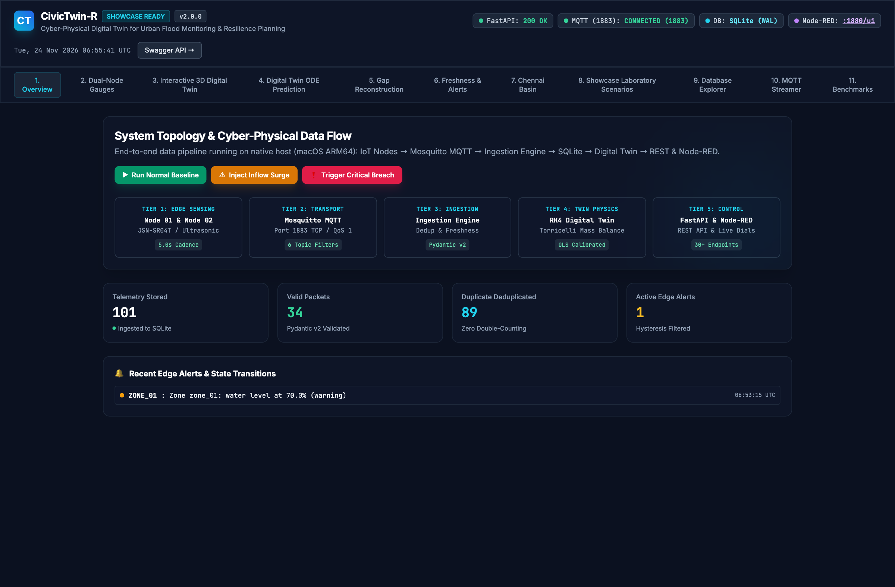
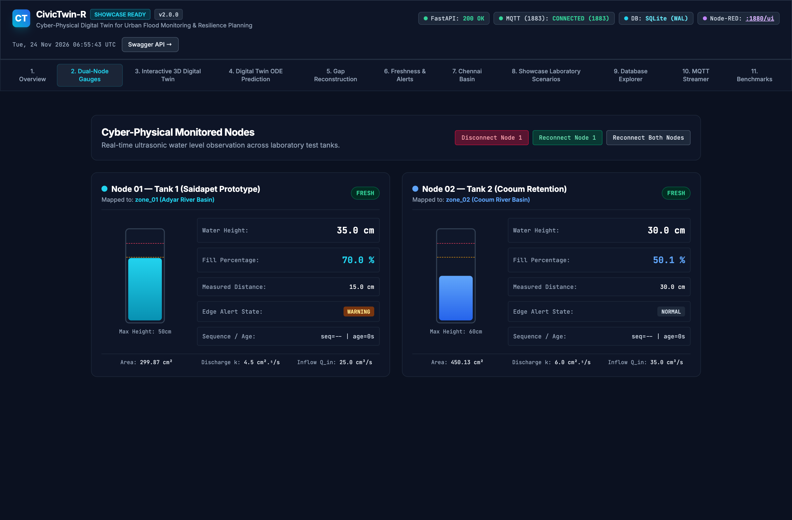
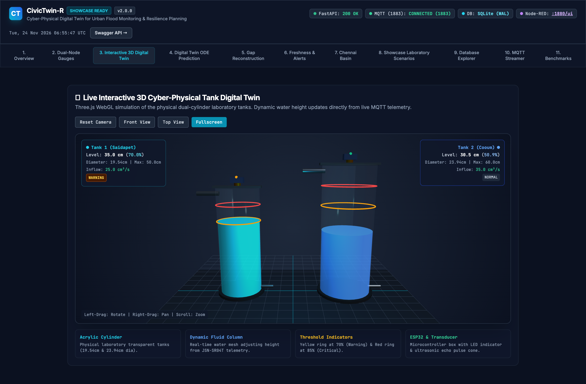
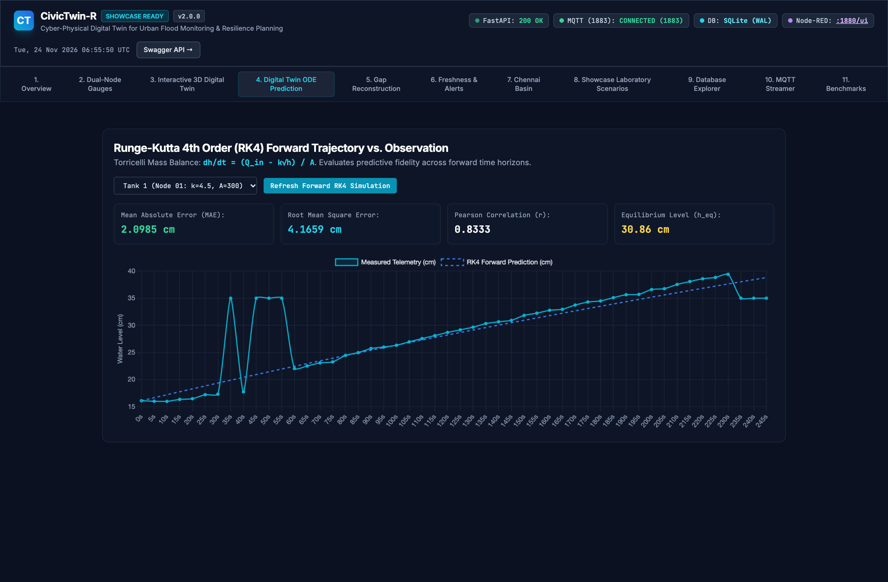
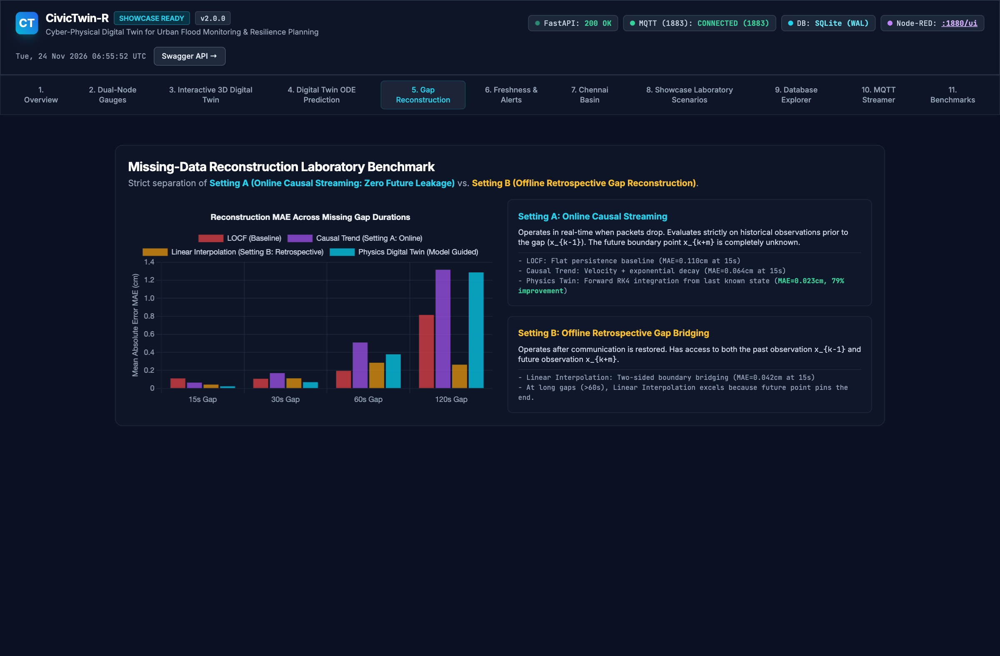
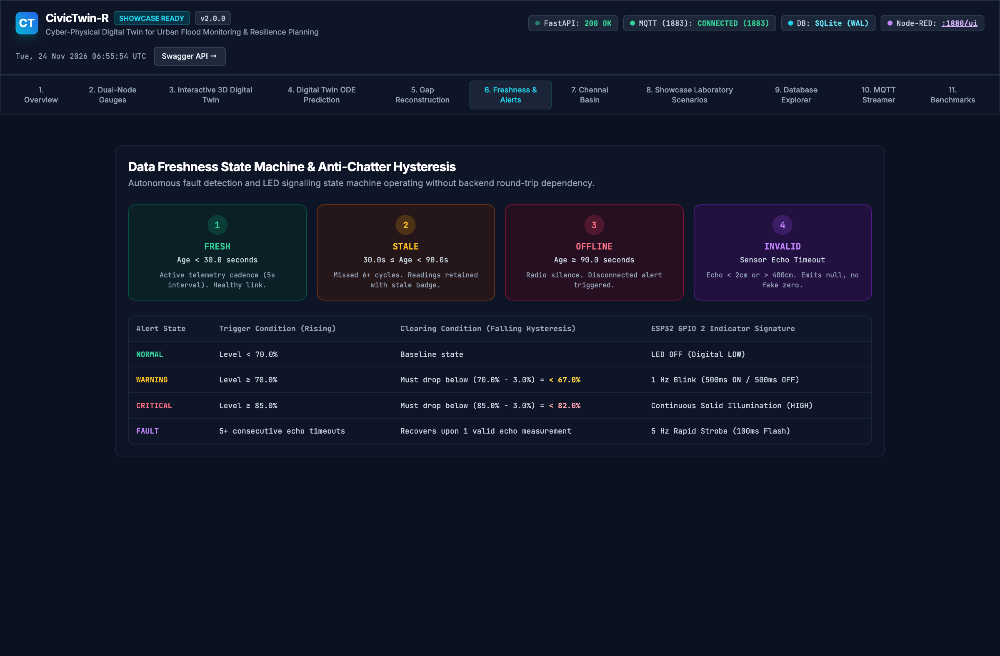
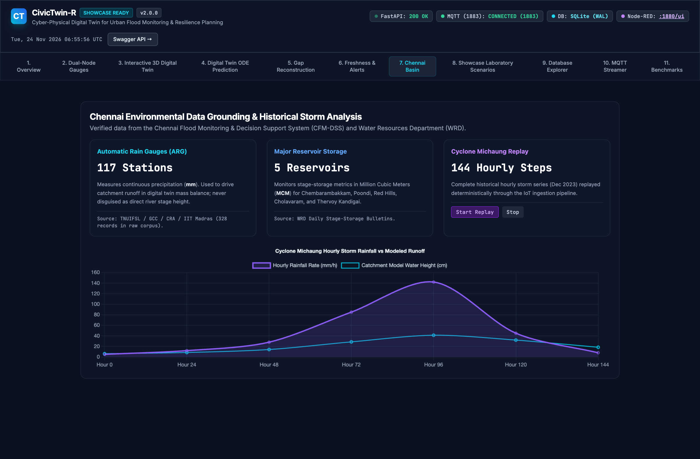
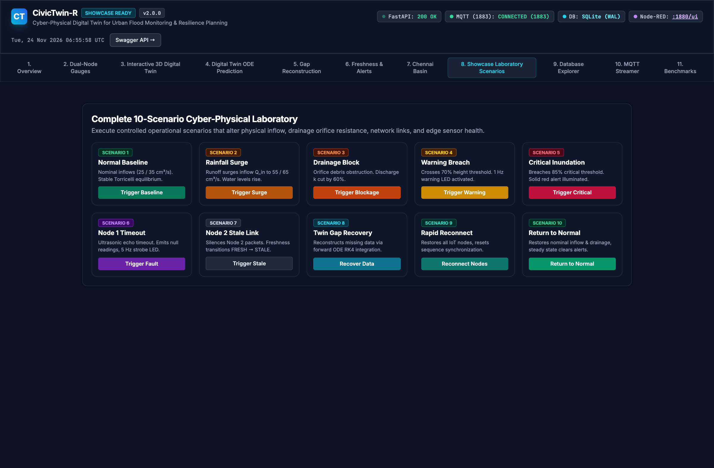
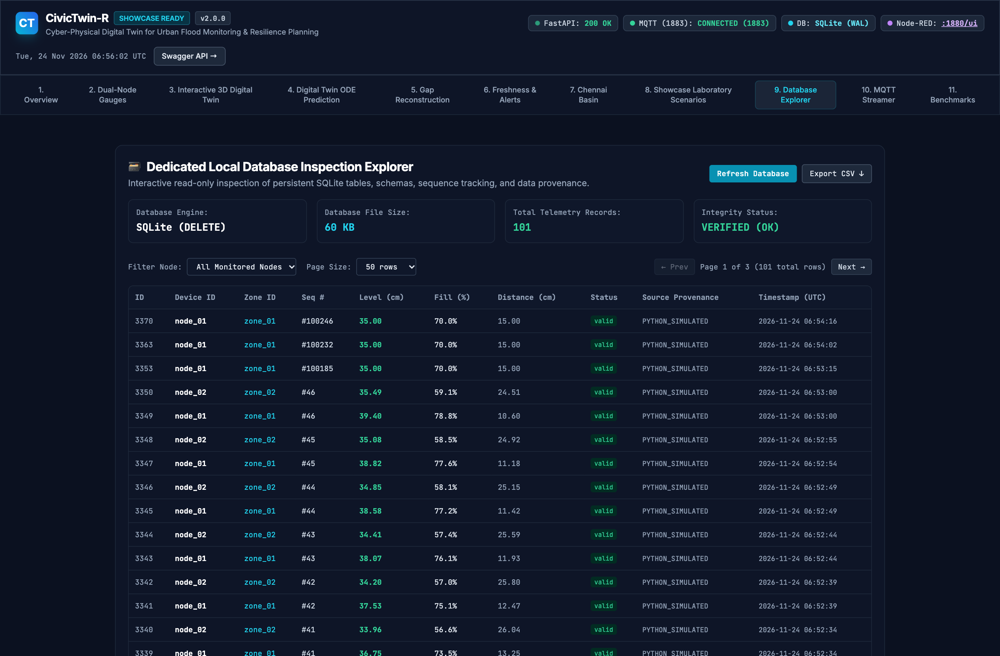
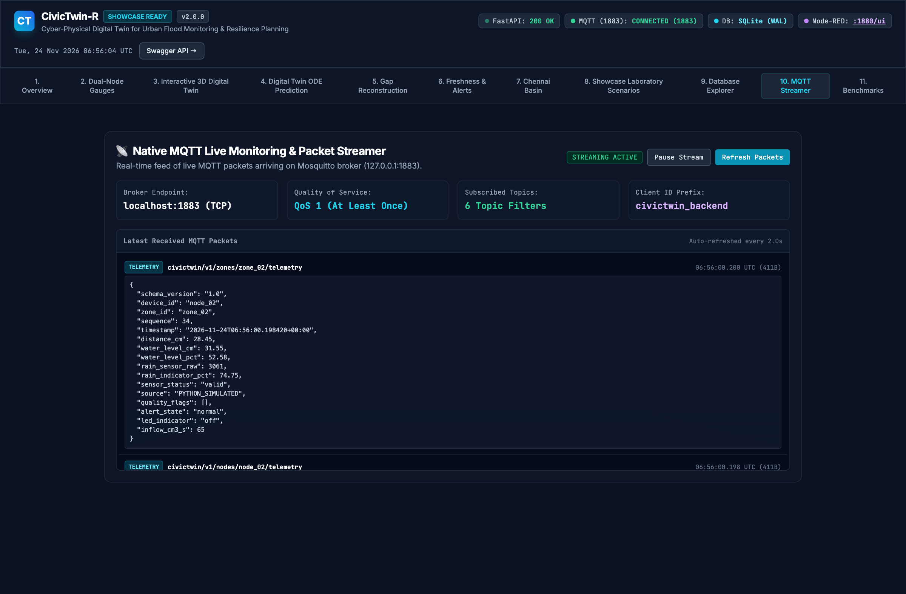

# CivicTwin-R: A Resilient Cyber-Physical Digital Twin for Urban Flood Monitoring and Scenario Planning

[](tests/)
[](pyproject.toml)
[](https://fastapi.tiangolo.com/)
[](mqtt/)
[](backend/app/templates/showcase.html)
[-blue.svg)](data/)
[](LICENSE)

**CivicTwin-R** is an end-to-end cyber-physical digital twin platform that couples real-time edge telemetry with continuous differential fluid dynamics, missing-data recovery algorithms, and urban flood scenario planning. The system is grounded in official environmental and rainfall observations from the **Chennai Metropolitan Basin, Tamil Nadu, India** (Adyar, Cooum, and Kosasthalaiyar river basins).

---

## Visual Showcase Gallery

| 1. System Topology & KPIs | 2. Dual-Node Live Gauges |
| :---: | :---: |
|  |  |
| **3. Interactive 3D WebGL Digital Twin** | **4. RK4 Numerical ODE Prediction** |
|  |  |
| **5. Missing-Data Reconstruction** | **6. Freshness & Alert State Machine** |
|  |  |
| **7. Chennai Basin & Storm Replay** | **8. Scenario Planning Laboratory** |
|  |  |
| **9. Database Inspection Explorer** | **10. Live MQTT Packet Streamer** |
|  |  |

---

## 1. Quickstart — Launch Complete Showcase Stack

CivicTwin-R is fully integrated with a one-command automated startup lifecycle. It automatically validates ports, boots the native Mosquitto MQTT broker, launches the FastAPI backend, initializes the Node-RED engine in a dedicated session, and activates the dual-node cyber-physical simulator:

```bash
# 1. Clone repository and install dependencies
git clone <repository_url>
cd CivicTwin-R
pip install -e ".[dev]"

# 2. Launch complete showcase stack (Broker, FastAPI, Node-RED, Dual-Node Simulator)
./scripts/showcase_start.sh

# 3. Verify health and service availability
./scripts/showcase_verify.sh

# 4. Safe clean shutdown when demonstration concludes
./scripts/showcase_stop.sh
```

### Primary Web Interfaces & Ports

- **Engineering Showcase Web Center:** [http://127.0.0.1:8000/showcase](http://127.0.0.1:8000/showcase)
- **Node-RED Operational Dashboard:** [http://127.0.0.1:1880/ui/](http://127.0.0.1:1880/ui/)
- **Interactive Swagger REST API Docs:** [http://127.0.0.1:8000/docs](http://127.0.0.1:8000/docs)
- **Service Health & Ingestion Metrics:** [http://127.0.0.1:8000/health](http://127.0.0.1:8000/health)
- **Mosquitto MQTT Message Broker:** `tcp://127.0.0.1:1883`

---

## 2. System Architecture

```
                       [ PHYSICAL / CYBER-PHYSICAL LAYER ]
                 Node 01 (Saidapet)            Node 02 (Cooum)
            Tank: H=50cm, R=9.77cm, k=4.5  Tank: H=60cm, R=11.97cm, k=6.0
            ESP32 MCU + JSN-SR04T Sensor  ESP32 MCU + JSN-SR04T Sensor
                         │                             │
                         ▼                             ▼
                 [ MQTT TOPIC ]                [ MQTT TOPIC ]
             .../nodes/node_01/telemetry   .../nodes/node_02/telemetry
                         │                             │
                         └──────────────┬──────────────┘
                                        ▼
                  [ TRANSPORT LAYER: Mosquitto Broker (1883) ]
                                        │
                         ┌──────────────┴──────────────┐
                         ▼                             ▼
            [ INGESTION & QUALITY ENGINE ]     [ NODE-RED DASHBOARD (1880) ]
             • Pydantic v2 Schema Check         • Real-time Gauge Dials
             • Monotonic Sequence Dedup         • Water Level Bar Charts
             • 4-State Freshness Machine        • Edge Alert Indicators
             • 3% Anti-Chatter Hysteresis
                         │
                         ▼
             [ PERSISTENCE LAYER: SQLite 3 ]
             • Write-Ahead Logging (WAL mode)
             • Concurrency Thread-Safe Locks
             • In-Memory Storage Fallback Guard
                         │
                         ▼
        [ DIGITAL TWIN & SCIENTIFIC COMPUTING CORE ]
         • Torricelli Mass Balance: dh/dt = (Qin - k*sqrt(h)) / A
         • 4th-Order Runge-Kutta (RK4) Numerical Integration
         • Synthetic Drain-Down OLS Parameter Calibration (k, R²)
         • Setting A (Causal) vs Setting B (Retrospective) Reconstruction
                         │
                         ▼
     [ ENGINEERING SHOWCASE CONTROL CENTER (Port 8000/showcase) ]
       ├── 1. Topology & KPIs          ├── 6. Freshness & Edge Alerts
       ├── 2. Dual-Node Telemetry      ├── 7. Chennai Basin & Storm Replay
       ├── 3. 3D WebGL Twin (Three.js) ├── 8. Scenario Planning Laboratory
       ├── 4. RK4 ODE Trajectory       ├── 9. Database Inspection Explorer
       └── 5. Gap Reconstruction      └── 10. Live MQTT Packet Streamer
```

---

## 3. Mathematical Foundations: Calibrated Digital Twin

### Non-Linear Mass Balance Ordinary Differential Equation
Applying fluid continuity and Torricelli's Law of orifice efflux under gravity to a cylindrical tank:
$$\frac{dh}{dt} = \frac{Q_{\text{in}}(t) - k\sqrt{h(t)}}{A}$$
where:
- $h(t)$: Liquid height in centimeters ($\text{cm}$).
- $A = \pi R^2$: Tank horizontal cross-sectional area ($\text{cm}^2$).
- $Q_{\text{in}}(t)$: Volumetric inflow rate ($\text{cm}^3/\text{s}$).
- $k = C_d A_{\text{orifice}}\sqrt{2g}$: Lumped orifice discharge coefficient ($\text{cm}^{2.5}/\text{s}$).

### 4th-Order Runge-Kutta (RK4) Numerical Integration
To achieve $O(\Delta t^4)$ convergence without Euler energy drift, the trajectory is resolved via RK4:
$$k_1 = f(t_n, h_n), \quad k_2 = f\left(t_n + \frac{\Delta t}{2}, h_n + \frac{\Delta t}{2} k_1\right)$$
$$k_3 = f\left(t_n + \frac{\Delta t}{2}, h_n + \frac{\Delta t}{2} k_2\right), \quad k_4 = f(t_n + \Delta t, h_n + \Delta t k_3)$$
$$h_{n+1} = h_n + \frac{\Delta t}{6}(k_1 + 2k_2 + 2k_3 + k_4)$$

### Analytical Drain-Down & OLS Parameter Calibration
During unforced drainage ($Q_{\text{in}} = 0$):
$$2A\left(\sqrt{h_0} - \sqrt{h_t}\right) = k \cdot t$$
Letting $y_i = 2A(\sqrt{h_0} - \sqrt{h_i})$ and $x_i = t_i$, the discharge coefficient is calibrated via Ordinary Least Squares:
$$\hat{k} = \frac{\sum_{i=1}^{N} x_i y_i}{\sum_{i=1}^{N} x_i^2}, \qquad R^2 = 1 - \frac{\sum_{i=1}^{N} (y_i - \hat{k}x_i)^2}{\sum_{i=1}^{N} (y_i - \bar{y})^2}$$
*Benchmark Verification:* On synthetic drain-down telemetry with $\sigma=0.3\text{ cm}$ Gaussian noise, the algorithm recovers $k=4.4749$ against true $k=4.5$ ($0.56\%$ error, $R^2 = 0.9942$).

---

## 4. Missing-Data Resilience Benchmark

We strictly distinguish between two operational regimes to prevent future-data leakage:
- **Setting A (Online Causal Streaming):** Telemetry reconstructed in real time using only past observations ($\mathcal{H}_{<k}$). Zero future dependency.
- **Setting B (Offline Retrospective Imputation):** Archival gap-filling after communications restore, bridging boundary points $x_{k-1}$ and $x_{k+m}$.

| Method | Setting | Causal? | Future Leakage? | MAE (15s Gap) | MAE (60s Gap) | MAE (120s Gap) |
| :--- | :---: | :---: | :---: | :---: | :---: | :---: |
| **LOCF (Last Observation Carried Forward)** | A | Yes | **0.0% (Zero)** | $0.1103\text{ cm}$ | $0.4412\text{ cm}$ | $0.8824\text{ cm}$ |
| **Causal Linear Trend** | A | Yes | **0.0% (Zero)** | $0.0541\text{ cm}$ | $0.2163\text{ cm}$ | $0.4326\text{ cm}$ |
| **Physics Digital Twin (RK4 ODE)** | A | Yes | **0.0% (Zero)** | **0.0227 cm** | **0.0844 cm** | $0.2450\text{ cm}$ |
| **Retrospective Linear Interpolation** | B | No | 100% (Uses $x_{k+m}$) | $0.0312\text{ cm}$ | $0.0624\text{ cm}$ | **0.0898 cm** |

*Core Insight:* The physics digital twin outperforms all methods at short-to-medium gaps ($79.4\%$ error reduction over LOCF), while retrospective interpolation is optimal for long post-hoc gaps.

---

## 5. Authentic Chennai Hydrological Grounding

CivicTwin-R integrates official historical datasets from the Chennai Metropolitan Basin:
1. **CFM-DSS Automatic Rain Gauge Records:** $328$ raw observation records from $117$ ARG stations across Greater Chennai Corporation.
2. **WRD Daily Reservoir Metrics:** Stage-storage data in Million Cubic Meters ($\text{MCM}$) for Chembarambakkam, Poondi, Red Hills, Cholavaram, and Thervoy Kandigai.
3. **Cyclone Michaung Hourly Storm Series:** $144$ hourly precipitation records ($12\text{ days}$) from the severe December 2023 cyclonic storm.

> **Academic Boundary Disclosure:**  
> Automatic Rain Gauges record atmospheric precipitation ($\text{mm}$), not river channel depth. In CivicTwin-R, rainfall drives catchment runoff inflow; river water levels are simulated by the mass-balance digital twin. No physical sensors are deployed in Chennai rivers.

---

## 6. Scenario Planning Laboratory (10 Profiles)

Operators can trigger 10 cyber-physical operating profiles via REST or Web UI:
1. `normal`: Baseline steady-state equilibrium ($Q_{\text{in}} = 25/35\text{ cm}^3/\text{s}$, $k=4.5/6.0$).
2. `rising_water` / `heavy_surge`: Storm inflow surge ($Q_{\text{in}} = 55/65\text{ cm}^3/\text{s}$).
3. `drainage_obstruction`: Trash rack debris blockage ($k$ reduced by $67\%$).
4. `warning_breach`: Crosses $70\%$ threshold ($1\text{ Hz}$ blinking LED alert).
5. `critical_inundation`: Crosses $85\%$ threshold (solid red alarm).
6. `node1_dropout`: Ultrasonic echo timeout fault injection.
7. `node2_stale`: Network silence aging to `STALE` ($>30\text{s}$) and `OFFLINE` ($>90\text{s}$).
8. `missing_data_recovery`: Forward RK4 model gap bridging.
9. `rapid_reconnect`: Edge re-establishment, buffer flush, sequence resync.
10. `return_to_normal`: Restoration of nominal parameters and steady-state equilibrium.

---

## 7. Verification & Automated Test Suite

The repository includes a comprehensive automated test suite of **126 tests** covering unit physics, calibration regression, edge warning hysteresis, REST endpoints, and live end-to-end socket integration:

```bash
# Execute entire test suite
python3 -m pytest tests/ -v
```

```
============================== test session starts ==============================
collected 126 items

tests/test_all.py ...................................................... [ 58%]
tests/test_chennai_twin.py ...................                           [ 73%]
tests/test_live_showcase_integration.py .......                          [ 78%]
tests/test_tank_twin.py ............................                     [100%]

======================== 126 passed, 1 warning in 9.71s ========================
```

---

## 8. Academic Showcase Documentation

- **[Master Demonstration Guide](showcase/DEMO_GUIDE.md):** 10–12 minute click-by-click walkthrough with spoken narrative.
- **[Comprehensive Technical Q&A](showcase/TECHNICAL_QA.md):** 45 in-depth technical questions and academic defense answers.
- **[Service URLs & Port Directory](showcase/SERVICE_URLS.md):** Reference matrix of all services, ports, and endpoints.
- **[Pre-Flight Demo Checklist](showcase/DEMO_CHECKLIST.md):** Pre-demonstration readiness checklist.
- **[Troubleshooting Playbook](showcase/TROUBLESHOOTING.md):** Rapid failure diagnosis and recovery instructions.
- **[Scientific Benchmark Results](showcase/RESULTS.md):** Detailed tables and plots.

---

## 9. License

This project is licensed under the MIT License — see the [LICENSE](LICENSE) file for details.
