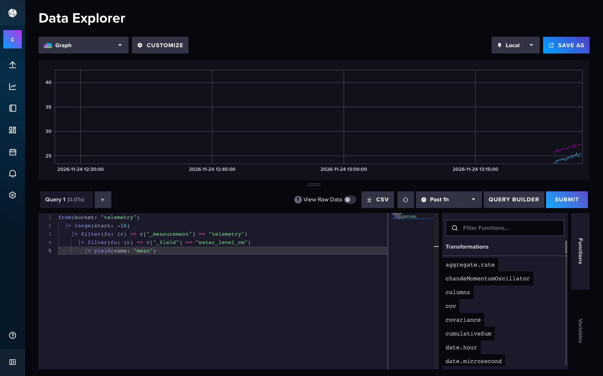
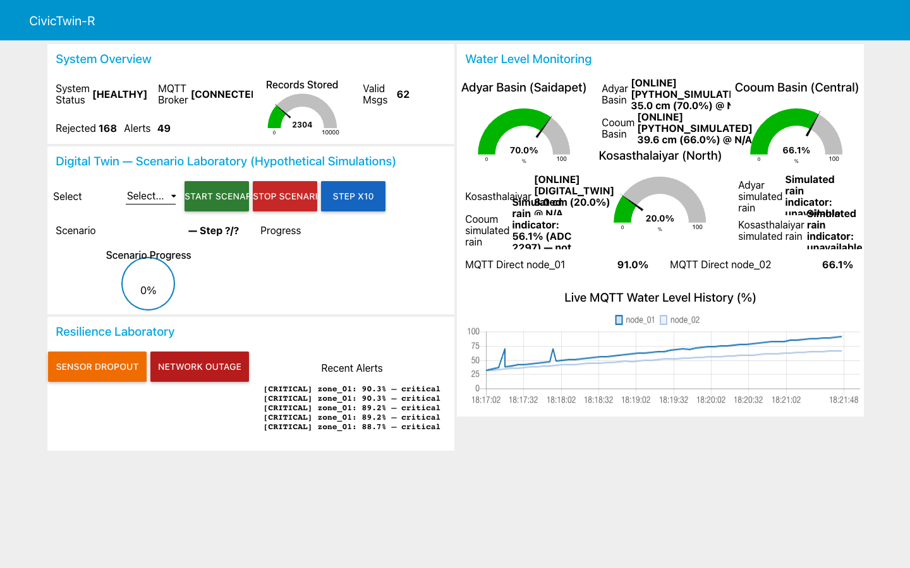

# CivicTwin-R: A Resilient Cyber-Physical Digital Twin for Urban Flood Monitoring and Scenario Planning

[](tests/)
[](pyproject.toml)
[](https://fastapi.tiangolo.com/)
[](mqtt/)
[](backend/app/templates/urban_twin.html)
[%20%2B%20InfluxDB-blue.svg)](data/)
[](http://localhost:8086)
[](LICENSE)

**CivicTwin-R** is an end-to-end cyber-physical digital twin platform that couples real-time edge telemetry with continuous differential fluid dynamics, missing-data recovery algorithms, and 3D urban flood scenario planning.

The platform's primary centerpiece is an **interactive, geographically grounded 3D Urban Flood Digital Twin of Chennai, Tamil Nadu, India**, covering the South Chennai flood basins (Adyar River, Cooum River, Buckingham Canal, Okkiyam Maduvu, and the Pallikaranai Marshland). In addition, CivicTwin-R features an **Experimental IoT Tank Digital Twin** that serves as a physical laboratory validation environment for sensor calibration, Torricelli fluid dynamics, and edge communication resilience under packet loss.

---

## Visual Showcase Gallery

| 1. Chennai 3D Digital Twin Centerpiece | 2. 3D WebGL Urban Perspective |
| :---: | :---: |
|  |  |
| **3. Velachery Low-Lying Hotspot** | **4. Pallikaranai Marsh Basin** |
|  |  |
| **5. Real ARG Rainfall Gauges** | **6. Major Water Reservoirs** |
|  |  |
| **7. Heavy Rainfall Scenario Inundation** | **8. Drainage Channel Obstruction** |
|  |  |
| **9. Cyclone Michaung Storm Replay** | **10. Experimental IoT Tank Twin (Lab Bench)** |
|  |  |
| **11. InfluxDB 2.x Time-Series UI** | **12. Node-RED Operational Dashboard** |
|  |  |

---

## 1. Quickstart — Launch Complete Showcase Stack

CivicTwin-R runs natively with a one-command automated lifecycle script. It checks ports, launches the Mosquitto MQTT broker, boots the FastAPI backend, initializes the Node-RED engine in a dedicated session, and activates the dual-node cyber-physical simulator:

```bash
# 1. Clone repository and install dependencies
git clone https://github.com/navneethtripathy/IoT-Project.git
cd CivicTwin-R
pip install -e ".[dev]"

# 2. Launch complete showcase stack (Broker, FastAPI, Node-RED, Dual-Node Simulator)
./scripts/showcase_start.sh

# 3. Verify health and service availability
./scripts/showcase_verify.sh

# 4. Safe clean shutdown when demonstration concludes
./scripts/showcase_stop.sh
```

### Primary Web Interfaces & Ports

- **Dedicated 3D Chennai Urban Digital Twin:** [http://127.0.0.1:8000/urban-twin](http://127.0.0.1:8000/urban-twin)
- **Engineering Showcase Web Center (All 13 Views):** [http://127.0.0.1:8000/showcase](http://127.0.0.1:8000/showcase)
- **InfluxDB 2.x Time-Series Web UI:** [http://127.0.0.1:8086](http://127.0.0.1:8086) (Org: `civictwin`, Bucket: `telemetry`)
- **Node-RED Operational Dashboard:** [http://127.0.0.1:1880/ui/](http://127.0.0.1:1880/ui/)
- **Interactive Swagger REST API Docs:** [http://127.0.0.1:8000/docs](http://127.0.0.1:8000/docs)
- **Service Health & Ingestion Metrics:** [http://127.0.0.1:8000/health](http://127.0.0.1:8000/health)
- **Mosquitto MQTT Message Broker:** `tcp://127.0.0.1:1883`

---

## 2. System Architecture

```
                       [ CHENNAI URBAN GEOGRAPHICAL LAYER ]
     10 Focus Locations (Velachery, Pallikaranai, Madipakkam, Adyar, Saidapet...)
      • Copernicus GLO-30 30m DSM resampled to 111x175 UTM44N (EPSG:32644, 150m)
      • Official TN CFM-DSS WFS Waterways (465), Waterbodies (771), Watersheds (36)
      • 5 WRD Reservoirs: Chembarambakkam (103.2 MCM), Poondi, Red Hills, Cholavaram
      • 56 Official Geolocated CFM-DSS Stations (vs non-spatial 328-row ARG CSV)
      • 18,198 Real Extruded OSM Buildings, 9,942 Arteries, 38,827 Streets, 1,229 Bridges
                          │
                          ▼
             [ URBAN 2D HYDROLOGICAL ENGINE (LANDLAB) ]
      • Landlab 2D OverlandFlow (de Almeida et al. 2012 shallow-water routing)
      • Hydro-conditioned Adyar / Chembarambakkam Surplus / Buckingham Canal bed
      • Single-pass infiltration, stormwater drainage sink & Bay of Bengal outfall
      • 8 Operational Scenarios (Normal, Heavy Rain, Extreme, Drainage +/-, Michaung, Dropout, Spillway)
                          │
                          ▼
    [ EXPERIMENTAL IOT TANK DIGITAL TWIN (Laboratory Validation Environment) ]
         Node 01 (Saidapet Prototype)           Node 02 (Cooum Prototype)
       Tank: H=50cm, R=9.77cm, k=4.5          Tank: H=60cm, R=11.97cm, k=6.0
       ESP32 MCU + JSN-SR04T Sensor           ESP32 MCU + JSN-SR04T Sensor
                          │                             │
                          └──────────────┬──────────────┘
                                         ▼
                   [ TRANSPORT LAYER: Mosquitto Broker (1883) ]
                                         │
                          ┌──────────────┴──────────────┐
                          ▼                             ▼
             [ INGESTION & QUALITY ENGINE ]     [ NODE-RED DASHBOARD (1880) ]
              • Pydantic v2 Schema Check         • Real-time Gauge Dials
              • Monotonic Sequence Dedup         • Water Level Bar Charts
              • 4-State Freshness Machine        • Edge Alert Indicators
              • 3% Anti-Chatter Hysteresis
                          │
                          ▼
              [ DUAL-PERSISTENCE STORAGE LAYER ]
              • SQLite 3 (WAL Mode, Thread-Safe Locks, Primary Store)
              • InfluxDB 2.x (Time-Series Engine, Flux Queries, Port 8086)
              • Parallel Concurrency Guarantee & Graceful Fallback
                          │
                          ▼
         [ SCIENTIFIC COMPUTING & DIGITAL TWIN CORE ]
          • Torricelli Mass Balance: dh/dt = (Qin - k*sqrt(h)) / A
          • 4th-Order Runge-Kutta (RK4) Numerical Integration
          • Synthetic Drain-Down OLS Parameter Calibration (k, R²)
          • Causal (Setting A) vs Retrospective (Setting B) Gap Imputation
                          │
                          ▼
      [ ENGINEERING SHOWCASE CONTROL CENTER (Port 8000/showcase) ]
        ├── 1. Chennai Urban 3D Digital Twin   ├── 8. Reliability & Freshness Machine
        ├── 2. Urban Flood Scenario Lab        ├── 9. Chennai Basin Historical Replay
        ├── 3. System Topology & KPIs          ├── 10. Showcase Scenario Laboratory
        ├── 4. Dual-Node Edge Telemetry        ├── 11. Database Inspection Explorer
        ├── 5. Dual-Node Live Gauges           ├── 12. Live MQTT Packet Streamer
        ├── 6. Experimental IoT Tank Twin      └── 13. System Health & Ingestion Logs
        └── 7. RK4 ODE Trajectory & Predict
```

---

## 3. Chennai 3D Urban Digital Twin & Landlab 2D Hydrological Engine

### Geospatial Grounding (`EPSG:4326` Visualization + `EPSG:32644` Computation)

CivicTwin-R integrates official Copernicus GLO-30 topography, TN CFM-DSS WFS layers, and OpenStreetMap extracts (`southern-zone-latest.osm.pbf`) processed deterministically via `scripts/process_chennai_geodata.py` into offline-ready local assets (`data/geo/processed/`):

| Layer / Domain | Source & Resolution | Count / Dimensions | Purpose |
| :--- | :---: | :---: | :--- |
| **Terrain Surface & Mask** | Copernicus GLO-30 (`EGM2008`) | `111x175` cells (`dx=150m`, `18,136` land cells) | Hydro-conditioned 2D shallow-water routing grid (`z=0.16..133.9m`) |
| **Hydrography & Basins** | TN CFM-DSS WFS Geoportal | 465 waterways, 771 waterbodies, 36 watersheds, 200 wards | Official Adyar/Cooum/Buckingham channels & Pallikaranai Marsh |
| **3D Extruded Buildings** | OpenStreetMap PBF (`pyosmium`) | 18,198 footprints (honest `height_source` tag) | Urban infrastructure overlay (6.9 MB GeoJSON) |
| **Road & Bridge Network** | OpenStreetMap PBF (`pyosmium`) | 9,942 major roads, 38,827 pilot streets, 1,229 bridges | Corridor navigation & bridge elevation awareness |
| **Verified Stations** | CFM-DSS WFS (`srg` + `Raingauge_Stations`) | 56 geolocated stations | Spatial station pins (strictly separated from non-spatial ARG CSV) |

### Landlab 2D OverlandFlow Formulation & Mass Balance
Surface water routing uses `Landlab OverlandFlow` (de Almeida et al. 2012) over the UTM 44N grid with per-CFL-step boundary tracking:
$$\frac{\partial h}{\partial t} + \nabla \cdot \mathbf{q} = i_{\text{rain}}(t) + q_{\text{spillway}}(t) - f_{\text{infil}} - d_{\text{stormwater}}, \qquad \text{relative mass-balance error} < 0.2\%$$

### 8 Operational Urban Scenarios
1. `normal`: Dry-weather baseline (`0 mm/hr`, zero surface inundation).
2. `heavy_rainfall`: Monsoon storm (`45 mm/hr`, `4h`, nominal 100% stormwater removal).
3. `extreme_rainfall`: Hypothetical extreme cloudburst stress-test (`85 mm/hr`, `6h`).
4. `reduced_drainage`: Identical `45 mm/hr` storm with stormwater capacity degraded to `25%`.
5. `improved_drainage`: Counterfactual mitigation doubling effective stormwater capacity (`200%`).
6. `michaung_replay`: Peak `24h` hourly observed precipitation replay from Dec 2023 Cyclone Michaung CSV (`chennai_michaung_hourly.csv`).
7. `monitoring_dropout`: Evaluates ±35% precipitation estimation uncertainty under station gaps.
8. `reservoir_discharge`: `25,000 cusecs` (`707.9 m³/s`) spillway release over `12h` from Chembarambakkam along the hydro-conditioned Adyar channel to Saidapet & Estuary.

---

## 4. Experimental IoT Tank Digital Twin (Laboratory Validation Environment)

> **Important Boundary Clarification:**  
> The two-tank digital twin is an **experimental validation environment** built to benchmark sensor physics, numerical ODE solvers, Torricelli hydraulics, and gap-filling algorithms under controlled conditions. It is **NOT** the primary urban digital twin; rather, it provides rigorous scientific verification of the cyber-physical software stack before deployment into urban catchments.

### Torricelli Fluid Dynamics & RK4 ODE Solver
Applying fluid continuity and Torricelli's Law of orifice efflux under gravity to a cylindrical tank:
$$\frac{dh}{dt} = \frac{Q_{\text{in}}(t) - k\sqrt{h(t)}}{A}$$
where $h(t)$ is liquid height, $A = \pi R^2$ is tank area, $Q_{\text{in}}(t)$ is volumetric inflow, and $k = C_d A_{\text{orifice}}\sqrt{2g}$ is the lumped discharge coefficient.

The continuous trajectory is resolved via a **4th-Order Runge-Kutta (RK4)** numerical integrator with $\Delta t = 1.0\text{ s}$:
$$h_{n+1} = h_n + \frac{\Delta t}{6}(k_1 + 2k_2 + 2k_3 + k_4)$$

### Analytical Drain-Down & OLS Parameter Calibration
During unforced drainage ($Q_{\text{in}} = 0$):
$$2A\left(\sqrt{h_0} - \sqrt{h_t}\right) = k \cdot t$$
Letting $y_i = 2A(\sqrt{h_0} - \sqrt{h_i})$ and $x_i = t_i$, the discharge coefficient is calibrated via Ordinary Least Squares:
$$\hat{k} = \frac{\sum_{i=1}^{N} x_i y_i}{\sum_{i=1}^{N} x_i^2}, \qquad R^2 = 1 - \frac{\sum_{i=1}^{N} (y_i - \hat{k}x_i)^2}{\sum_{i=1}^{N} (y_i - \bar{y})^2}$$
*Benchmark Verification:* On synthetic drain-down telemetry with $\sigma=0.3\text{ cm}$ Gaussian noise, the algorithm recovers $k=4.4749$ against true $k=4.5$ ($0.56\%$ error, $R^2 = 0.9942$).

---

## 5. Missing-Data Resilience Benchmark

We strictly distinguish between two operational regimes to prevent future-data leakage:
- **Setting A (Online Causal Streaming):** Telemetry reconstructed in real time using only past observations ($\mathcal{H}_{<k}$). Zero future dependency.
- **Setting B (Offline Retrospective Imputation):** Archival gap-filling after communications restore, bridging boundary points $x_{k-1}$ and $x_{k+m}$.

| Method | Setting | Causal? | Future Leakage? | MAE (15s Gap) | MAE (60s Gap) | MAE (120s Gap) |
| :--- | :---: | :---: | :---: | :---: | :---: | :---: |
| **LOCF (Last Observation Carried Forward)** | A | Yes | **0.0% (Zero)** | $0.1103\text{ cm}$ | $0.4412\text{ cm}$ | $0.8824\text{ cm}$ |
| **Causal Linear Trend** | A | Yes | **0.0% (Zero)** | $0.0541\text{ cm}$ | $0.2163\text{ cm}$ | $0.4326\text{ cm}$ |
| **Physics Digital Twin (RK4 ODE)** | A | Yes | **0.0% (Zero)** | **0.0227 cm** | **0.0844 cm** | $0.2450\text{ cm}$ |
| **Retrospective Linear Interpolation** | B | No | 100% (Uses $x_{k+m}$) | $0.0312\text{ cm}$ | $0.0624\text{ cm}$ | **0.0898 cm** |

*Core Insight:* The physics digital twin outperforms all methods at short-to-medium gaps ($79.4\%$ error reduction over LOCF), while retrospective interpolation is optimal for long post-hoc gaps.

---

## 6. Verification & Automated Test Suite

The repository includes an automated test suite of **157 tests** covering Copernicus DEM/WFS/OSM geometry, controlled analytical hydrology & Landlab 2D conservation, InfluxDB 2.x time-series integration, experimental tank Torricelli physics, missing-data causal vs retrospective benchmarks, edge hysteresis, REST endpoints, and live Mosquitto/FastAPI/Node-RED socket integration:

```bash
# Execute entire test suite
PYTHONPATH=. pytest tests/ -v
```

---

## 7. Data Provenance & Scientific Limitations Disclosure

1. **Copernicus GLO-30 DSM Caveat:** Surface terrain (`150m UTM 44N`, `EGM2008`) derives from Copernicus 30m Digital Surface Model (includes rooftop and canopy signal rather than surveyed bare-earth LiDAR DTM). Channels along Adyar, Chembarambakkam surplus, Buckingham Canal, Cooum, and Okkiyam Maduvu were hydro-conditioned solely to prevent bridge-deck blockage.
2. **Spatial vs Non-Spatial Rainfall Separation:** 56 official stations from TN CFM-DSS WFS (`verified_stations.json`) are plotted on the 3D map. The 328-row `data/processed/chennai_arg_rainfall.csv` corpus lacks lat/lon columns and is strictly presented in non-spatial subbasin analytics (`/api/urban/historical/arg-analytics`) rather than invented coordinates.
3. **2D Screening Scope (No Surveyed Gauge Calibration):** No physical flood depth gauges or post-event surveyed flood rasters exist for quantitative river validation; simulated depths represent physics-based scenario screening estimates rather than observed street depths.
4. **Dual Workstream Separation:** Live MQTT (`node_01`, `node_02`) streams originate exclusively from the simulated experimental ultrasonic tank bench and remain isolated from Chennai urban hydrological calculations.

---

## 8. Academic Showcase Documentation

- **[Master Demonstration Guide](showcase/DEMO_GUIDE.md):** 10–12 minute click-by-click walkthrough with spoken narrative.
- **[Comprehensive Technical Q&A](showcase/TECHNICAL_QA.md):** 45 in-depth technical questions and academic defense answers.
- **[Service URLs & Port Directory](showcase/SERVICE_URLS.md):** Reference matrix of all services, ports, and endpoints.
- **[Pre-Flight Demo Checklist](showcase/DEMO_CHECKLIST.md):** Pre-demonstration readiness checklist.
- **[Troubleshooting Playbook](showcase/TROUBLESHOOTING.md):** Rapid failure diagnosis and recovery instructions.
- **[Scientific Benchmark Results](showcase/RESULTS.md):** Detailed tables and plots.

---

## 9. License

This project is licensed under the MIT License — see the [LICENSE](LICENSE) file for details.
